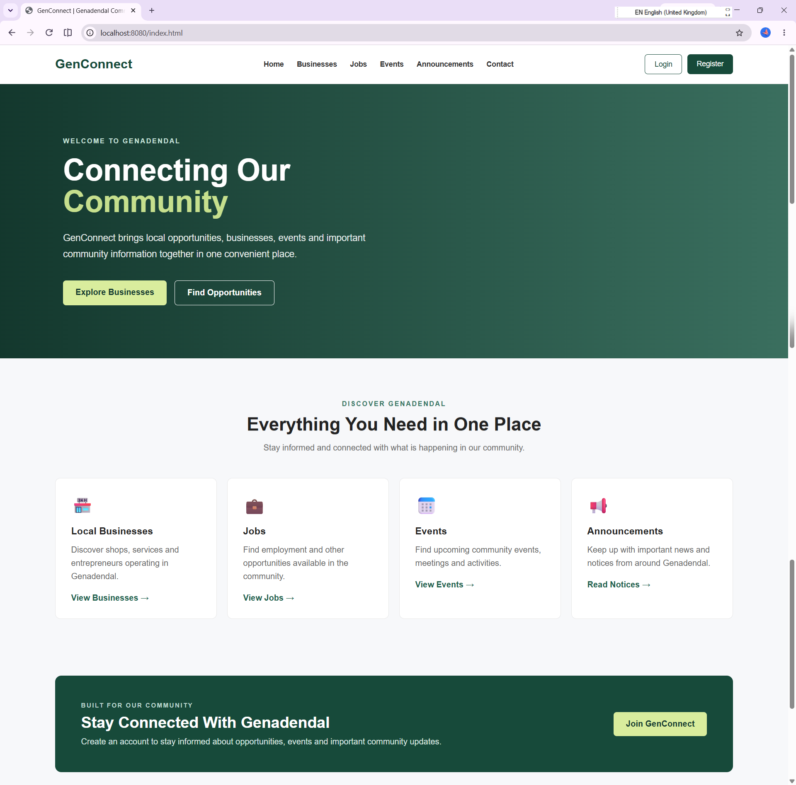
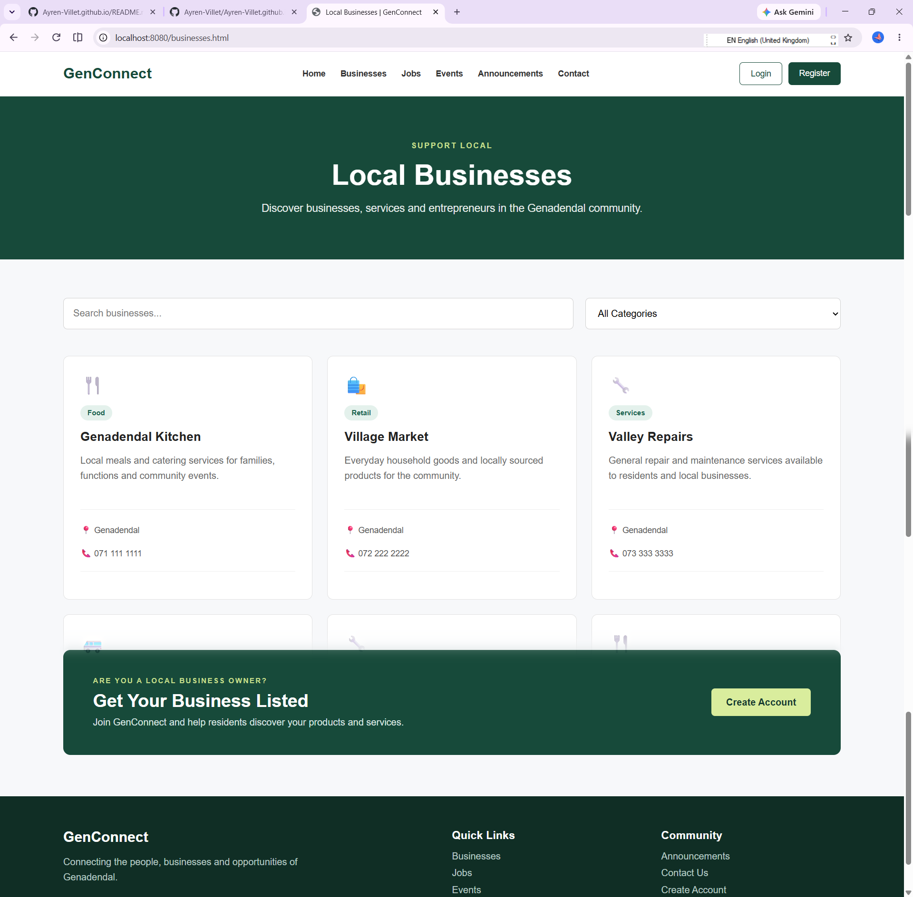
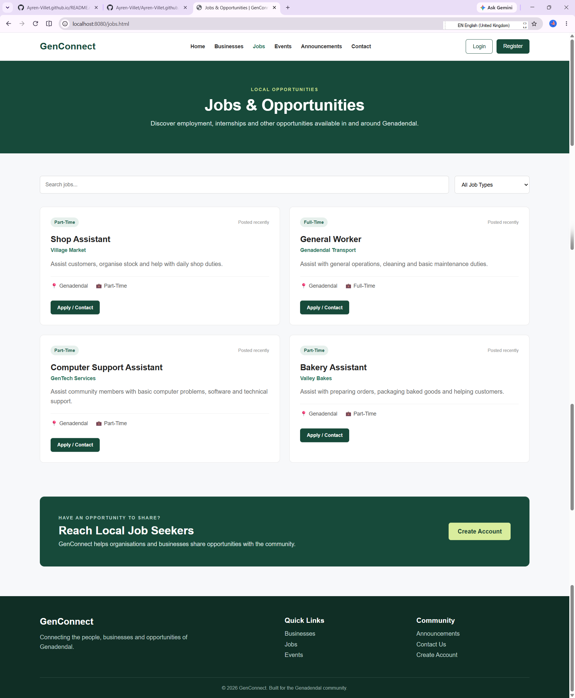
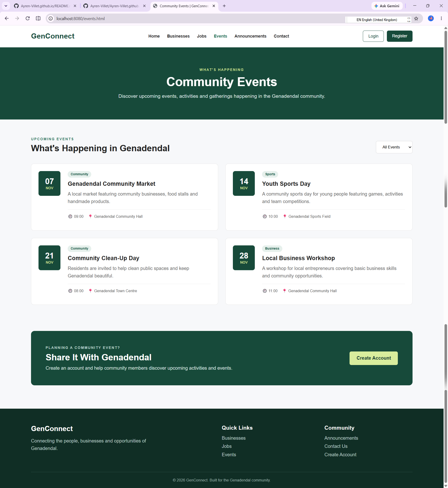
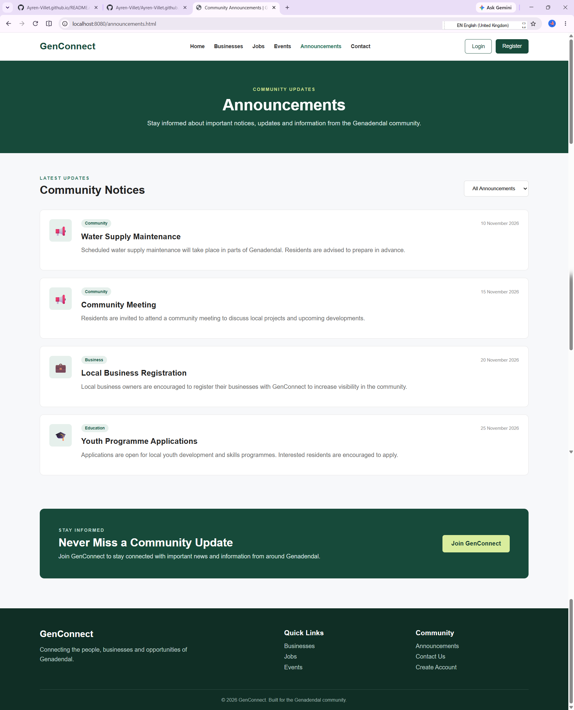
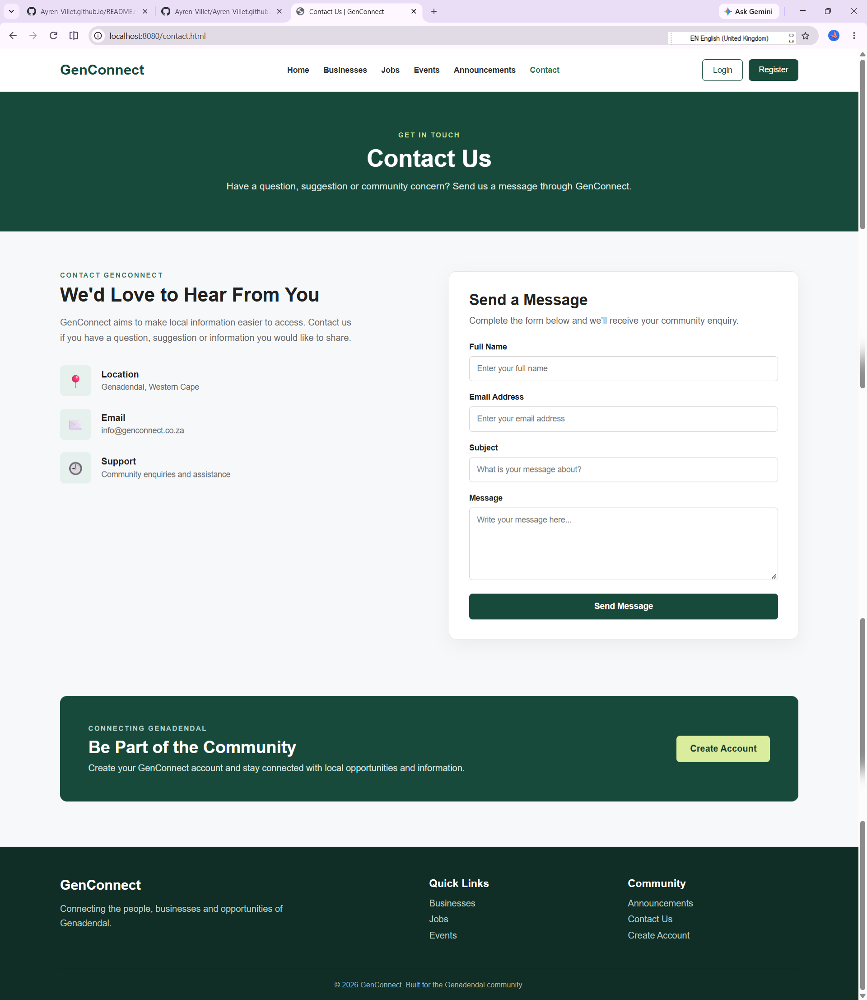
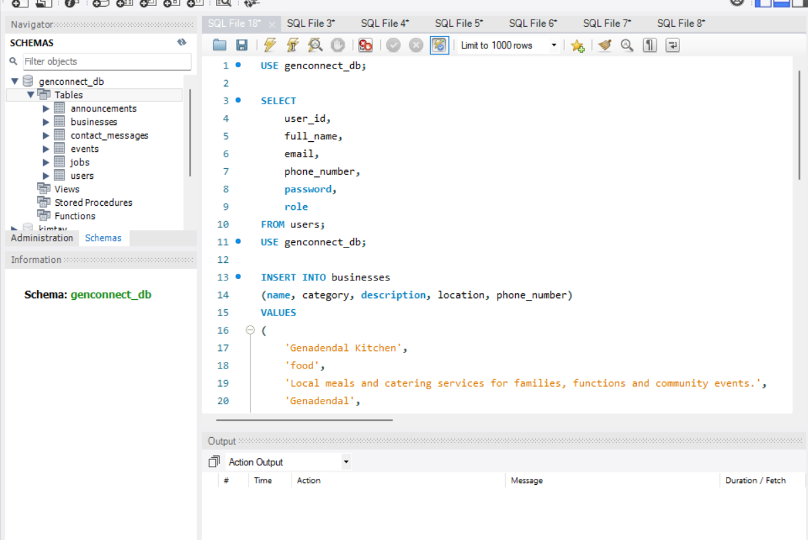
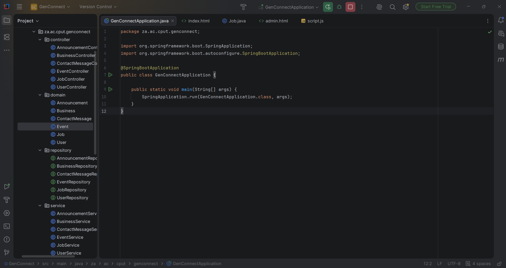
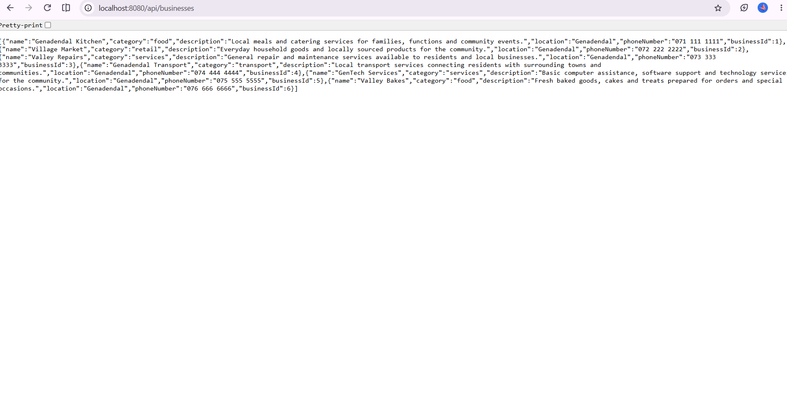

# Ayren Villet  
📍 Cape Town, South Africa  
📧 223120030@mycput.ac.za  
📞 0732976839  

---

## Professional Overview
I am currently a 3rd year student at the Cape Peninsula University of Technology pursuing a Diploma in ICT: Applications Development. I enjoy problem-solving and working as part of a team. I am adaptable and eager to expand my skills and knowledge to become a valuable asset to any organization.

---

## Education

**Diploma in Information Technology** 
Cape Peninsula University of Technology  
2024 – Present  

**National Senior Certificate (Grade 12)**  
Groenberg Secondary School  
2021  

---

## Skills

### Technical Skills
- Java  
- SQL  
- UX/UI Design  
- Microsoft Office
<video width="600" controls>
  <source src="CV/AyrenInterview(1).mp4" type="video/mp4">
  Your browser does not support the video tag.
</video>

### Soft Skills
- Communication  
- Teamwork  
- Time Management  
- Leadership  
- Adaptability  
- Project Management  

---

## Academic Projects

### Student Accommodation Mobile App
- Developed a mobile application in a group setting for student accommodation applications  
- Focused on usability, data handling, and practical functionality  

### Student Project Registration Database
- Designed a database system for student project registration and deregistration  
- Created tables, relationships, and basic queries for data management  

---

## Work Experience

### IT Assistant  
**Apex Primary School**  
February 2023 – September 2023  
- Taught younger pupils how to use desktop computers  
- Assisted students with a Maths application  
- Performed basic troubleshooting  
- Handled filing and administrative tasks  
- Filled in for teachers when absent  

### Library Assistant   
**Genadendal Library (YearBeyond – 1000 Stories)**  
March 2022 – December 2022  
- Assisted with aftercare programs  
- Read stories and supported struggling learners  
- Organized and sorted library books  
- Managed book check-in and check-out system  

---

## References

### Grace Present  
- 👩‍💼Occupation: Librarian  
- 📍Company: Theewaterskloof  
- 📧Email: grace.present44@gmail.com  
- 📞Contact: 0742294099  

### Courtney Moodley  
- 👩‍💼Occupation: Mentor  
- 📍Company: YearBeyond  
- 📧Email: admin@yearbeyond.org  
- 📞Contact: 0631506103

  ---

## REFLECTION (STAR method)
### Reflection on Coding in Markdown

**Situation:**  
As part of creating my digital portfolio, I had to learn how to use Markdown to structure and present my CV on GitHub.

**Task:**  
My task was to convert my CV into Markdown format while making sure it remained professional, readable, and well-organised.

**Action:**  
First, I found Markdown confusing because it was unknown to me and I was not used to writing code for formatting. I struggled with things like headings, spacing, and aligning content properly. Instead of giving up, I practiced using different Markdown features such as headings, bullet points, and bold text. I kept testing my work on GitHub to see how it displayed and fixed mistakes until it looked correct.

**Result:**  
Through this process, I improved my attention to detail and problem-solving skills. I became more comfortable using Markdown. This experience showed me that even if I struggle at first, practicing consistently helps me improve and achieve a professional result.

### Reflection on Mock Interview Experience 

**Situation:**  
I participated in a mock interview as part of my work readiness training to prepare for real-world job interviews.

**Task:**  
I needed to present myself professionally, answer questions confidently, and demonstrate my skills and personality effectively.

**Action:**  
 I felt nervous and unsure about how to answer certain questions, especially when I had to think on the spot. Some of my answers were not well-structured at first. However, I did not give up. I practiced answering common interview questions and focused on improving how I spoke, including my tone, confidence, and clarity. I also worked on staying calm and thinking before responding.

**Result:**  
By the end of the process, I became more confident in expressing myself and answering questions clearly. I learned the importance of preparation and communication during interviews. This experience helped me develop confidence, adaptability, and better problem-solving skills, which will be valuable in real interview situations.

### Reflection on Using GitHub Pages

**Situation:**  
For the portfolio project, I was required to publish my work using GitHub Pages to create an online digital portfolio.

**Task:**  
My task was to take my GitHub repository and successfully deploy it as a live website that showcases my CV, mock interview, and reflections.

**Action:**  
At first, I found the process challenging because I had never used GitHub Pages before. I struggled with understanding how to publish the site and make sure everything displayed correctly. I explored the settings, followed the required steps, and kept testing my link. When things did not work, I went back to fix errors and tried again until the site was successfully published.

**Results:**
At the end I could freely work with Github pages with no errors and no confusion.

---

# Project Presentation 3 – Agile Portfolio of Evidence

## GenConnect Project

This section presents my Agile Portfolio of Evidence for Project Presentation 3. It demonstrates the planning, development, implementation, and reflection completed throughout my project.

The portfolio includes evidence and reflections for the following areas:

- Agile Team Charter
- User Stories and Tasks
- Product Backlog
- Sprint Backlog
- Agile Logbook

---

## 1. Agile Team Charter

### Project Name
**GenConnect**

### Project Purpose

The purpose of GenConnect is to develop a community-focused web application for Genadendal. The platform provides a central place where community members can access useful local information, including businesses, job opportunities, events and announcements.

The project also allows me to apply the technical and project management skills I have developed during my studies.

### Project Objectives

- Develop a functional and user-friendly community website.
- Provide information about local businesses.
- Allow users to view jobs and opportunities.
- Display community events and announcements.
- Create an easy-to-use interface.
- Connect the front-end screens to backend RESTful services.
- Store and retrieve information using a database.
- Apply Agile principles throughout the project.

### Technologies and Tools

- HTML
- CSS
- JavaScript
- Java
- Spring Boot
- MySQL
- IntelliJ IDEA
- GitHub

### Core Values

**Communication:** Maintain clear communication regarding project progress and challenges.

**Accountability:** Take responsibility for assigned work and ensure that tasks are completed.

**Collaboration:** Work effectively with others and assist where necessary.

**Quality:** Test implemented features and ensure that they function correctly.

**Continuous Improvement:** Use feedback and testing to continuously improve the solution.

### Working Agreements

- Tasks should be clearly identified before development begins.
- Development work should be divided into manageable tasks.
- Completed functionality should be tested.
- Project progress should be documented.
- Changes and challenges should be recorded.
- Source code should be maintained using GitHub.
- Product and Sprint Backlogs should be updated as development progresses.

### Definition of Done

A task is considered complete when:

- The required functionality has been implemented.
- The feature works as expected.
- The feature has been tested.
- Major errors have been resolved.
- Front-end and backend communication works where required.
- Database functionality works where required.
- Evidence of the completed work has been recorded.

  ### Evidence

The following evidence demonstrates the planning and Agile practices used during the project:

- Agile Team Charter documentation.
- GitHub repository showing project development.
- Project planning and development documentation.

**Figure 1:** Agile Team Charter outlining the project's purpose, objectives, values and working agreements.

### Reflection

Creating the Agile Team Charter helped me understand the importance of establishing clear objectives and working agreements during a software development project.

The charter provided direction for the project by identifying the purpose, objectives, responsibilities and standards that needed to be followed.

One of the most important lessons I learned was that software development involves more than writing code. Planning, communication, documentation, testing and managing changes are also important parts of successfully completing a project.

During the development process, I worked with different parts of the application, including the front-end screens, backend functionality, RESTful services and database integration. This gave me a better understanding of how the different layers of a web application work together.

I also learned that project plans can change as development progresses. Some tasks required additional troubleshooting and adjustments before they worked correctly. Using an Agile approach made it easier to break larger problems into smaller tasks and work through them individually.

Overall, the Agile Team Charter provided a useful foundation for the project and improved my understanding of how Agile practices can support the software development process.

---

## 2. User Stories and Tasks

User stories were created to describe the GenConnect system requirements from the perspective of the end user.

The format used was:

**As a [type of user], I want [functionality], so that [benefit].**

Each user story was then divided into smaller development tasks.

### User Story 1 – View Local Businesses

**User Story:**  
As a community member, I want to view local businesses so that I can easily find businesses and services available in the community.

**Tasks:**
- Create the Businesses page.
- Design business cards using HTML and CSS.
- Create the Business backend functionality.
- Create REST API endpoints for businesses.
- Connect the Businesses page to the REST API using JavaScript.
- Retrieve business information from the database.
- Add business search functionality.
- Add category filtering.
- Test the functionality.

**Priority:** High

### User Story 2 – View Jobs and Opportunities

**User Story:**  
As a job seeker, I want to view available jobs and opportunities so that I can find employment opportunities within or around the community.

**Tasks:**
- Create the Jobs page.
- Design job cards.
- Create the Job backend functionality.
- Create REST API endpoints for jobs.
- Connect the Jobs page to the backend using JavaScript.
- Retrieve job information from the database.
- Add job search functionality.
- Add job type filtering.
- Test the functionality.

**Priority:** High

### User Story 3 – View Community Events

**User Story:**  
As a community member, I want to view upcoming events so that I can know what activities are taking place in the community.

**Tasks:**
- Create the Events page.
- Design the event display.
- Create the required backend functionality.
- Connect the Events page to the backend.
- Display event information.
- Test the functionality.

**Priority:** Medium

### User Story 4 – View Announcements

**User Story:**  
As a resident, I want to view community announcements so that I can stay informed about important information and updates.

**Tasks:**
- Create the Announcements page.
- Design the announcement section.
- Create backend functionality for announcements.
- Connect the page to the backend.
- Retrieve announcement information.
- Test the functionality.

**Priority:** Medium

### User Story 5 – Contact GenConnect

**User Story:**  
As a user, I want access to contact information so that I can communicate when I need assistance or additional information.

**Tasks:**
- Create the Contact page.
- Design the contact section.
- Add the required contact information.
- Add navigation to the Contact page.
- Test the page.

**Priority:** Medium

### Evidence

The following evidence demonstrates how the project requirements were converted into user stories and development tasks:

- Completed GenConnect website pages.
- GitHub repository containing the implemented functionality.
- Backend REST API functionality supporting the user stories.

**Figure 4:** GenConnect Businesses and Jobs functionality developed from the identified user stories.

### Reflection

Creating user stories helped me understand how system requirements can be described from the perspective of the end user instead of only focusing on technical implementation.

Breaking each user story into smaller tasks made the development process easier to manage. For example, allowing users to view businesses required several smaller tasks, including creating the user interface, developing backend functionality, creating REST API endpoints and connecting the front-end to the backend.

This process also improved my understanding of the relationship between the front-end, backend and database. A feature that appears simple to a user can require several components behind the scenes before it works correctly.

During development, I experienced situations where functionality did not work immediately. I had to troubleshoot issues with the backend, database connection and communication between JavaScript and the RESTful services. Solving these problems improved my debugging and problem-solving skills.

Overall, user stories helped me keep each feature focused on the needs of the user, while the individual tasks provided a clear plan for implementing each requirement.

---

## 3. Product Backlog

The Product Backlog contains the features, improvements and technical tasks required for the GenConnect project. The backlog was prioritized according to the importance of each requirement.

| ID | Product Backlog Item | Priority | Status |
|---|---|---|---|
| PB01 | Create GenConnect project structure | High | Completed |
| PB02 | Design the GenConnect homepage | High | Completed |
| PB03 | Create website navigation | High | Completed |
| PB04 | Create Businesses page | High | Completed |
| PB05 | Add business search functionality | High | Completed |
| PB06 | Add business category filtering | Medium | Completed |
| PB07 | Connect Businesses page to REST API | High | Completed |
| PB08 | Create backend functionality for businesses | High | Completed |
| PB09 | Create Jobs page | High | Completed |
| PB10 | Add job search functionality | High | Completed |
| PB11 | Add job type filtering | Medium | Completed |
| PB12 | Connect Jobs page to REST API | High | Completed |
| PB13 | Create backend functionality for jobs | High | Completed |
| PB14 | Create Events page | Medium | Completed |
| PB15 | Create Announcements page | Medium | Completed |
| PB16 | Create Contact page | Medium | Completed |
| PB17 | Create Login page | High | Completed |
| PB18 | Create Registration page | High | Completed |
| PB19 | Configure Spring Boot backend | High | Completed |
| PB20 | Create RESTful web services | High | Completed |
| PB21 | Create MySQL database | High | Completed |
| PB22 | Connect Spring Boot to MySQL | High | Completed |
| PB23 | Test API responses | High | Completed |
| PB24 | Test front-end and backend integration | High | Completed |
| PB25 | Improve website styling and layout | Medium | Completed |
| PB26 | Create GenConnect logo and branding | Low | Completed |
| PB27 | Fix identified bugs and errors | High | Completed |
| PB28 | Organize project evidence for GitHub portfolio | High | Completed |
| PB29 | Complete portfolio reflections | High | Completed |
| PB30 | Publish updated portfolio using GitHub Pages | High | Completed |

### Prioritization

**High Priority:** Core functionality required for the application to operate, including the main pages, backend, RESTful services, database integration and testing.

**Medium Priority:** Supporting functionality and improvements such as filtering, events, announcements and interface improvements.

**Low Priority:** Additional improvements that enhance the appearance and identity of the application but are not essential for the core functionality.

### Evidence

The following evidence demonstrates how the Product Backlog was used to organize and prioritize the project requirements:

- Product Backlog containing the main GenConnect requirements.
- GitHub repository showing implementation of backlog items.
- Completed GenConnect functionality representing completed backlog items.

**Figure 5:** GenConnect Product Backlog showing prioritized development requirements.

### Reflection

Creating and maintaining the Product Backlog helped me understand the importance of prioritizing requirements during software development.

The backlog allowed me to identify which features were most important to the project. I focused first on establishing the project structure and developing the main functionality before moving on to additional improvements.

One of the most important lessons I learned was that a Product Backlog can change throughout development. Some tasks that initially appeared simple required additional work. For example, connecting the front-end screens to RESTful services required backend development, API testing and troubleshooting before the information could display correctly.

I also learned that technical problems can create additional work. Issues involving the database, backend configuration and front-end integration required troubleshooting and testing before development could continue.

As development progressed, completed items could be marked as completed while outstanding tasks remained visible. This made it easier to understand the current state of the project and determine what needed to be completed next.

Overall, the Product Backlog gave the project structure and helped me manage development in smaller, prioritized pieces instead of trying to complete everything at once.

---

## 4. Sprint Backlog

The Sprint Backlog was used to divide the project into smaller and more manageable stages. Each sprint focused on a specific goal and contained the tasks required to achieve that goal.

### Sprint 1 – Project Planning and Setup

**Sprint Goal:** Establish the project and create the foundation for development.

| Task | Priority | Status |
|---|---|---|
| Define the project purpose | High | Completed |
| Identify system requirements | High | Completed |
| Identify required functionality | High | Completed |
| Plan the project structure | High | Completed |
| Create initial project documentation | Medium | Completed |

### Sprint 2 – User Interface Development

**Sprint Goal:** Develop the main user-facing screens of the application.

| Task | Priority | Status |
|---|---|---|
| Create homepage | High | Completed |
| Create Businesses page | High | Completed |
| Create Jobs page | High | Completed |
| Create Events page | Medium | Completed |
| Create Announcements page | Medium | Completed |
| Create Contact page | Medium | Completed |
| Create Login and Registration pages | High | Completed |
| Add navigation between screens | High | Completed |
| Improve website styling | Medium | Completed |

### Sprint 3 – Backend and Database Development

**Sprint Goal:** Develop the backend infrastructure required to support the application.

| Task | Priority | Status |
|---|---|---|
| Configure Spring Boot | High | Completed |
| Configure Maven dependencies | High | Completed |
| Create MySQL database | High | Completed |
| Configure database connection | High | Completed |
| Create backend entities | High | Completed |
| Create repositories and services | High | Completed |
| Create REST controllers | High | Completed |
| Test Spring Boot application | High | Completed |
| Test database connection | High | Completed |

### Sprint 4 – Front-End and Backend Integration

**Sprint Goal:** Connect the user interface to the RESTful backend services.

| Task | Priority | Status |
|---|---|---|
| Create REST API endpoints | High | Completed |
| Connect Businesses page to API | High | Completed |
| Retrieve and display business information | High | Completed |
| Add business search and filtering | Medium | Completed |
| Connect Jobs page to API | High | Completed |
| Retrieve and display job information | High | Completed |
| Add job search and filtering | Medium | Completed |
| Test API responses | High | Completed |
| Resolve integration errors | High | Completed |

### Sprint 5 – Testing and Portfolio

**Sprint Goal:** Test the solution and prepare the final Portfolio of Evidence.

| Task | Priority | Status |
|---|---|---|
| Test website functionality | High | Completed |
| Test backend functionality | High | Completed |
| Test database integration | High | Completed |
| Resolve identified errors | High | Completed |
| Collect portfolio evidence | High | In Progress |
| Complete portfolio reflections | High | In Progress |
| Update GitHub Portfolio | High | In Progress |
| Publish updated GitHub Pages portfolio | High | To Do |

### Evidence

The following evidence demonstrates how the Sprint Backlog was used to organize and track project development:

- Sprint tasks showing completed and outstanding work.
- GitHub repository showing development progress.
- Screenshots of completed application functionality.
- Backend and database development evidence.

**Figure 6:** Sprint Backlog showing tasks organized according to sprint goals.

### Reflection

Using a Sprint Backlog helped me divide the project into smaller and more manageable stages. Instead of trying to develop the entire application at once, I could focus on specific goals and tasks.

The first stages focused on planning and developing the user interface. After establishing the front-end structure, I moved on to configuring Spring Boot and MySQL. This helped me understand why the order of development tasks is important because later functionality depended on earlier components being completed.

One of the most challenging stages was connecting the front-end screens to the backend RESTful services. Although the pages could display correctly, they still needed to communicate with the backend to retrieve application data.

Working through this process improved my understanding of how JavaScript, REST APIs, Spring Boot and MySQL interact within a web application.

The Sprint Backlog was also useful when problems occurred. Instead of treating an error as a problem with the entire project, I could identify the affected task, troubleshoot the issue and continue once it was resolved.

I also learned that completing code does not necessarily mean that a task is finished. The functionality needs to be tested to confirm that it works as expected.

Overall, using sprints improved the way I approached the project. It encouraged me to work incrementally, monitor my progress and focus on achievable goals.

---

## 5. Agile Logbook

The Agile Logbook was used to document my project activities, progress, challenges and learning throughout the Work Integrated Learning project.

It provides a record of how the project progressed from initial planning and requirements through business planning, solution architecture, development and reporting.

### July 2026

#### 14–17 July – Project Introduction and Planning

**Activities Completed:**
- Reviewed and understood the project requirements.
- Identified the problem that the project needed to address.
- Considered the purpose and target users of the proposed solution.
- Identified the initial project scope.
- Started identifying the main features required for the solution.

**Challenges:**  
One of the main challenges was determining an appropriate project scope that could realistically be completed within the available development period.

**What I Learned:**  
I learned that proper planning is important before development begins. Understanding the problem and requirements makes it easier to determine what functionality needs to be developed.

**Reflection:**  
This stage provided the foundation for the project and helped me understand that software development should begin with understanding the problem rather than immediately starting with coding.

#### 21–24 July – Agile Planning and Requirements

**Activities Completed:**
- Continued project planning and requirements analysis.
- Identified the main system requirements.
- Developed initial user stories.
- Broke larger requirements into smaller tasks.
- Prioritized project activities.
- Updated project documentation.

**Challenges:**  
Some requirements were broad and needed to be divided into smaller tasks before they could be implemented.

**What I Learned:**  
I learned how user stories describe functionality from the user's perspective and how larger requirements can be divided into manageable development tasks.

**Reflection:**  
This stage improved my understanding of Agile planning and helped me organize the project into clearer development goals.

#### 28–31 July – Business Model Development

**Activities Completed:**
- Worked on the business model submission.
- Identified the problem addressed by the proposed solution.
- Considered the intended users of the solution.
- Identified the value offered by the project.
- Prepared and reviewed the business model documentation.

**Challenges:**  
One challenge was connecting the technical solution to a clear value proposition and understanding why users would find the solution useful.

**What I Learned:**  
I learned that successful technology projects should address a genuine problem and provide clear value to their intended users.

**Reflection:**  
Completing the business model improved my understanding of the relationship between technology and entrepreneurship. It encouraged me to think about both how a solution works and why it should exist.

### August 2026

#### Solution Architecture

**Activities Completed:**
- Worked on the solution architecture for the project.
- Identified the major components required for the solution.
- Planned how the user interface, application functionality and database would interact.
- Considered the flow of information between different system components.
- Prepared the required solution architecture documentation.

**Challenges:**  
One challenge was understanding how the different components of the system should connect and work together.

**What I Learned:**  
I gained a better understanding of system architecture and how the front-end, backend and database form different layers of an application.

**Reflection:**  
The solution architecture stage helped me understand the importance of designing a system before implementing all of its components. Having a clear architecture makes development and troubleshooting easier.

#### August Monthly Report and Register

**Activities Completed:**
- Compiled the August monthly report.
- Documented work completed during the month.
- Recorded project progress and challenges.
- Completed the required register.
- Prepared the documentation for submission.

**What I Learned:**  
I learned the importance of documenting project progress regularly instead of relying on memory at the end of the project.

**Reflection:**  
The reporting process gave me an opportunity to review my progress and identify areas that still required attention. It also improved my professional documentation skills.

### September 2026

#### Project Development and Improvement

**Activities Completed:**
- Continued working on the project solution.
- Reviewed project requirements.
- Improved existing project components.
- Worked on system functionality.
- Tested developed functionality.
- Identified and resolved problems during development.

**Challenges:**  
Some technical problems required additional troubleshooting before development could continue. Certain functionality required several attempts before working correctly.

**What I Learned:**  
I improved my debugging and problem-solving skills. I also learned that software development is an iterative process where functionality is continuously developed, tested and improved.

**Reflection:**  
September provided more practical development experience. Solving technical problems helped build my confidence and demonstrated the importance of persistence during software development.

#### September Monthly Report and Register

**Activities Completed:**
- Prepared the September monthly report.
- Documented work completed during the month.
- Recorded development activities.
- Documented challenges and solutions.
- Completed the required register.
- Prepared the documentation for submission.

**What I Learned:**  
I learned how regular documentation can provide evidence of project progress and personal development.

**Reflection:**  
Looking back at the work completed during September helped me see the progress made since the initial planning stages. The project progressed from requirements and planning towards implementation, testing and improvement.

### Evidence

The following evidence demonstrates my project activities and progress throughout the Work Integrated Learning period:

- Weekly Agile Logbook documents.
- Business Model submission.
- Solution Architecture documentation.
- August Monthly Report and Register.
- September Monthly Report and Register.
- GitHub development history.
- Project development and testing evidence.

**Figure 8:** Agile Logbook documenting project activities and learning during July 2026.

**Figure 9:** Business Model evidence showing project planning and entrepreneurial development.

**Figure 10:** Solution Architecture evidence demonstrating the planned structure of the system.

**Figure 11:** August and September monthly reports demonstrating continued project progress and reflection.

### Overall Reflection

Maintaining an Agile Logbook throughout the project helped me track my activities and reflect on my learning and development.

At the beginning of the project, much of my work focused on understanding the problem, gathering requirements and planning the proposed solution. As the project progressed, my activities moved towards business planning, solution architecture, development, testing, troubleshooting and documentation.

One of the most important lessons I learned was that software development is an iterative process. Features do not always work correctly on the first attempt. Problems need to be identified, investigated and resolved before development can continue.

The project also improved my understanding of Agile development. Breaking work into smaller activities made it easier to monitor my progress and identify outstanding tasks.

Throughout the project, I developed skills in requirements analysis, Agile project management, system planning, software development, testing, troubleshooting and technical documentation.

Overall, the Agile Logbook provides evidence of my progress throughout the project and demonstrates how my knowledge and practical skills developed over time.

---

## Portfolio Conclusion

This Portfolio of Evidence demonstrates my development throughout the project, from initial planning and requirements analysis to implementation, testing and reflection.

The Agile Team Charter, User Stories and Tasks, Product Backlog, Sprint Backlog and Agile Logbook helped me organize the project and understand how Agile practices can be applied throughout the software development lifecycle.

The project also provided practical experience in planning, problem-solving, documentation and software development. The knowledge and skills gained throughout this process will contribute to my future academic and professional development.

---

## GenConnect Project Screenshots

The following screenshots provide visual evidence of the GenConnect community website, including its frontend pages, Spring Boot backend, MySQL database, and REST API integration.

### 1. Homepage

The homepage introduces GenConnect and provides navigation to the main community services.

### 2. Businesses Page

The Businesses page allows users to browse local businesses and use search and category filtering.

### 3. Jobs Page

The Jobs page displays local job opportunities and provides search and filtering functionality.

### 4. Events Page

The Events page provides information about community events.

### 5. Announcements Page

The Announcements page displays community notices and updates.

### 6. Contact Page

The Contact page provides a way for users to find community contact information.

### 7. MySQL Database

The MySQL database stores the information used by the GenConnect application.

### 8. Spring Boot Backend

The backend is developed using Java and Spring Boot, with controllers, services, repositories, and domain classes.

### 9. REST API Integration

The REST API provides data from the Spring Boot backend to the frontend.
